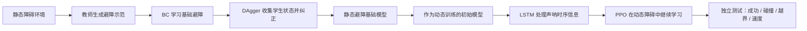
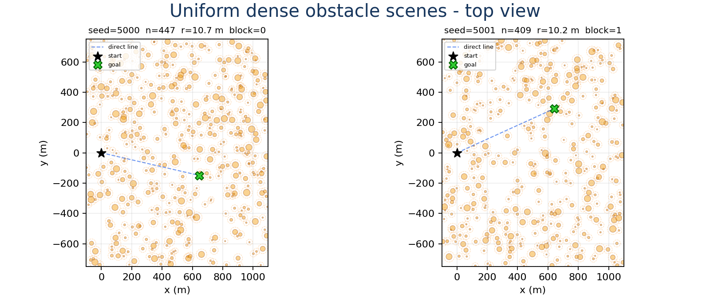
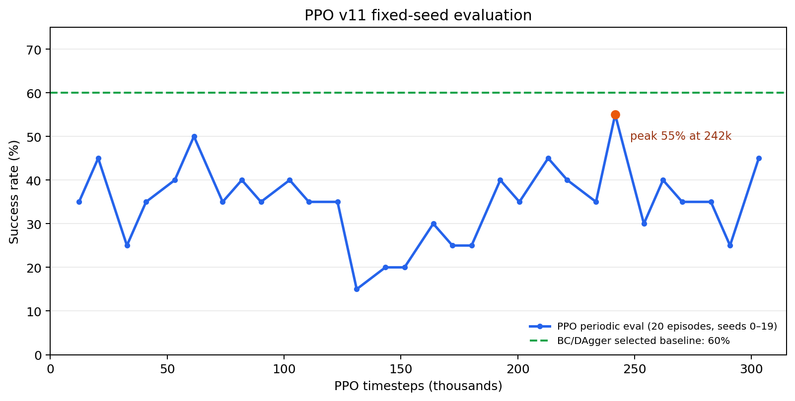

# 高速 UUV 动态避障：当前路线与阶段结果

> 更新日期：2026-11-21  
> 核心思路：先用 BC–DAgger 在静态障碍中学会基础避障，再以这个模型为起点，用 LSTM+PPO 学习动态障碍避让。  
> 当前状态：旧版 BC 高成功率不可信；移除信息泄露后的 BC/DAgger 才是有效基线。
> v11 已完成公平对照，并发现 PPO 选模基线混用了静态与动态场景。

## 一、研究路线

第一阶段，在静态环境中用教师生成示范动作，通过 BC 学习基础避障；再用 DAgger 收集学生自己走过的状态，让教师补充纠正动作，减少学生实际运行时偏离示范路线的问题。阶段目标是得到一个能在静态障碍中稳定前进的基础模型。

第二阶段，以基础模型作为起点，在动态障碍环境中训练。LSTM 从连续声呐信息中提取障碍物运动变化，PPO 通过与环境反复交互，进一步学会避让运动障碍。最后用独立场景检查成功率、安全性和速度。



*图 1：论文拟采用的两阶段训练路线。*

需要说明实现上的差别：v11 的 BC、DAgger 和 PPO 使用了同一套带声呐历史的模型；LSTM 输入在 BC/DAgger 阶段已经存在，并不是到 PPO 阶段才单独加上。v11 已经实现“静态模仿学习后转动态 PPO”的训练顺序，但还没有严格验证“静态基础模型”与“动态阶段 LSTM+PPO”各自带来的效果。后续实验要把这两个阶段的作用分开比较。

教师内部用 Dijkstra 规划路径并生成动作示范，但学生看不到地图、障碍物真值或 Dijkstra 路径。学生只根据声呐、目标信息和自身运动状态行动。**旧版 BC 的高成功率来自信息泄露：**当时全局特权信息错误地进入了学生模型，使成功率接近 100%。移除泄露后，学生只能依靠有限观测，成功率随之下降。旧版成绩不能作为当前方法的有效结果。



*图 2：场景分布示例。图中展示的是静态位置，不表示障碍物运动方向。v11 的起终点距离为 650–900 m，包含 300–450 个障碍；PPO 阶段障碍物以 1–10 节速度随机运动。*

## 二、v11 做到了什么

v11 完成了约 30 万 PPO 步。BC/DAgger 在固定的 20 个**静态**开发场景中成功率为 60%；切换到动态场景后，同一个 BC 模型只有 25%。PPO 在动态开发集上的最高成功率为 55%，最终模型为 45%。



*图 3：PPO 在固定开发场景上的成功率。绿色虚线是训练前 BC/DAgger 模型的 60% 成功率。*

v11 选择的 `ppo_kinematic.zip` 与 `bc_model.zip` 完全相同，说明检查点选择器最终保留了 BC/DAgger 模型。原因是代码把**静态场景 BC 的 60%**写成了 PPO 最佳模型基线，而后续 PPO 都在**动态场景**中评估，两者不是同一任务条件。

完成公平对照后：

| 模型 | 相同场景 | 成功率 |
|---|---|---:|
| BC | 20 个动态开发种子 | 25% |
| PPO 最终模型 | 20 个动态开发种子 | 45% |
| PPO 训练期间最高 | 20 个动态开发种子 | 55% |
| BC | 50 个独立动态种子 | 48% |
| PPO 最终模型 | 50 个独立动态种子 | 52% |

所以 PPO 确实改善了动态避障，但提升还不稳定：开发集提高约 20 个百分点，独立测试集只提高约 4 个百分点。

## 三、残差策略是什么

当前 PPO 不是直接重新学习一个完整策略，而是在 BC 动作上增加一个小修正：

```text
最终动作 = BC 基础动作 + 修正系数 × 残差动作
```

可以把 BC 策略理解成“已经会基本避障的驾驶员”，PPO 残差头理解成“站在旁边做小幅修正的副驾驶”：

- 基础驾驶员负责大方向，不会在 PPO 早期被完全破坏；
- 副驾驶员只修正动态障碍出现后的局部动作；
- 修正系数越大，PPO 能改变的行为越多，但破坏 BC 的风险也越高。

旧版修正系数只有 `0.15`，并且探索方差完全冻结。当前已调整为：

```text
residual_scale = 0.30
critic_warmup_steps = 30000
```

Critic warmup 结束后，残差动作头和探索方差一起开放学习；BC 特征和基础动作网络仍保持冻结。

## 四、PPO 选模修复

静态 BC 成功率现在只用于决定是否允许进入 PPO。进入 PPO 前，会再用 PPO 的动态开发环境评估同一个 BC 模型，并将这个动态结果作为 checkpoint 选择的公平基线。

因此后续不会再出现：

```text
静态 BC 60%  >  动态 PPO 55%
```

这种错误比较。模型选择将统一比较动态成功率、最终距离和碰撞率。

## 五、动态障碍暴露的问题

1. **静态训练和动态测试差别较大。** BC/DAgger 使用静态障碍；只有 PPO 阶段出现运动障碍。
2. **声呐记忆时间较短。** 8 帧历史覆盖约 2.8 秒，不能保留长期路线和死路信息。
3. **残差策略可修改范围仍有限。** 本次已从 0.15 放宽到 0.30，但仍冻结 BC 特征和基础动作网络。
4. **Critic 学习不稳定。** 训练中的 explained variance 经常较低，价值网络尚未稳定拟合高方差回报。
5. **安全和速度还没有同时达标。** PPO 最终模型独立测试成功率为 52%，碰撞率约 34%，平均速度仍明显低于 50 节。

## 六、TODO List

- [x] 统一 BC 与 PPO 的动态评估条件；
- [x] 修复静态 BC 与动态 PPO 混用选模基线的问题；
- [x] 将残差范围从 0.15 放宽到 0.30；
- [x] Critic warmup 从 10k 提高到 30k；
- [x] warmup 后允许探索方差学习；
- [x] 使用 20 个动态开发种子选择 checkpoint；
- [ ] 使用独立 50 个动态种子进行最终测试；
- [ ] 将静态 BC/DAgger 成功率提升到 75% 以上；
- [ ] 增加长期局部记忆或跨 episode recurrent hidden state；
- [ ] 加入 1–3、3–6、6–10 节动态障碍课程；
- [ ] 为 Critic 设置独立学习率；
- [ ] 碰撞率降到 20% 以下后再强化 50 节速度保持。

## 七、结论

论文基线路线为：**静态 BC–DAgger 学基础避障，再以该模型为起点，通过 LSTM+PPO 学习动态障碍避让。**

当前代码思路与这一路线一致，PPO 也比动态 BC 有改善。v11 的主要问题是模型选择条件混用、残差修改范围偏小、长期记忆不足和动态域偏移过大；这些问题已开始修复。

## 相关文件

- v11 配置：`output_model/ppo_v11_memoryfix/run.json`
- BC/DAgger 数据统计：`output_model/ppo_v11_memoryfix/bc_data_stats.json`
- 训练曲线数据：`output_model/ppo_v11_memoryfix/csv/progress.csv`
- 训练日志：`nohup_out/ppo_v11_memoryfix.log`
- 50 场景评估数据：`output_model/ppo_v11_memoryfix/evaluation/csv/evaluation_metrics.csv`
- 50 场景评估汇总：`output_model/ppo_v11_memoryfix/evaluation/evaluation_summary.json`
